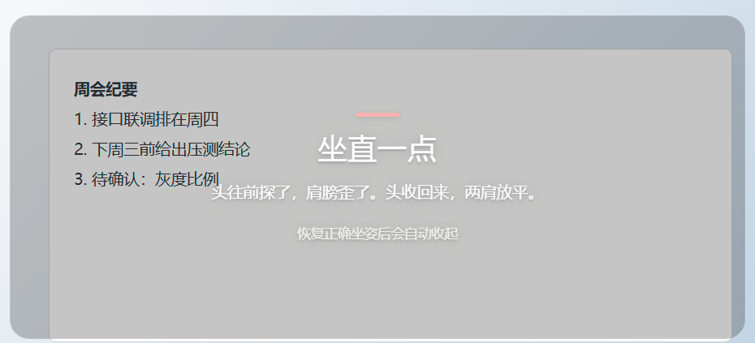

# PostureGuard

Watches your posture through your laptop camera. If you keep slouching during work hours, a semi-transparent card fades in at the center of your screen and tells you to sit up.

Camera frames are processed **in memory, on your machine only** — never recorded, uploaded, or written to disk.

[中文](README.md) · [Install](#install) · [Usage](#usage) · [Support](#support-the-author)

---

## The problem it solves

"Remember to sit up straight" does not work. Not because you do not know — because you do not notice that you *already* slid down.
Periodic reminders are too blunt: they fire while you are sitting fine, and stay silent while you collapse for an hour.

PostureGuard judges **continuously**. At 4 FPS it tracks head and shoulder keypoints and compares them to a baseline
you captured yourself — so your height, camera model, and desk height do not matter. It only cares how far you have
drifted from *your own* good posture.

## Features

**Four metrics, any one of them over threshold counts as slouching**

| Metric | Meaning | Default threshold (camera ahead) |
|---|---|---|
| Neck forward angle | Ear midpoint vs. shoulder midpoint, forward lean | Baseline +6° |
| Shoulder tilt | Height difference between shoulders | Baseline ±4° |
| Body sink | How many shoulder-widths lower your shoulders sit | Sink > 5% shoulder width |
| Head-turn gate | Nose offset from shoulder centerline | Above 0.15 × shoulder width, neck judging pauses |

Any violation accumulates time; 3.5 seconds of it raises the card. Sit back up for 3 seconds and it dismisses itself,
then stays quiet for 20 seconds.

**Also**

- **Camera position presets**: straight ahead / front-left 45° / front-right 45°, each with its own thresholds; switching voids the old calibration
- **Sitting reminder**: nudges you to stand up after N minutes (default 45) of continuous sitting
- **Work hours**: default weekdays 9:00–12:00 and 14:00–18:00; the camera is released outside them
- **Adjustable card opacity**: 40%–90%, default 60% — you can still see the desktop behind it
- **Bilingual UI**: Chinese and English, applies instantly and is remembered
- **Global hotkey** to pause during meetings or screen sharing
- **Tray resident**: closing the window does not stop detection
- **Multi-monitor**: pick which screen the card appears on, with live preview

**The card sits at 60% opacity by default — the desktop behind it stays readable:**



*Illustration — the document behind the card is fictitious*

## Install

Grab the latest installer from [Releases](../../releases):

- `PostureGuard-x.y.z-setup.exe` — installer, **per-user, no administrator rights required**
  (defaults to `%LOCALAPPDATA%\Programs\PostureGuard`, path is changeable), optional desktop shortcut
- `PostureGuard-x.y.z-portable.exe` — no install, good for a USB stick

Both share the same config, so settings survive switching between them.

**Requirements**: Windows 10/11 x64, a camera, and camera permission on first run.

## Usage

### 1. Confirm camera position

The settings panel opens on first launch. A laptop camera sits above the screen — pick "Straight ahead".
If the laptop stands beside you (common with an external monitor), pick front-left or front-right 45°.

The position decides the four recommended thresholds: at 45° the shoulder width is compressed to about 0.7×,
so every metric that divides by shoulder width is scaled up by the same factor. **A wrong position skews both
the calibration and the thresholds.**

### 2. Calibrate

Sit up straight, hit "Calibrate", hold for 5 seconds.

The app records your neck angle, shoulder tilt, shoulder height and shoulder width as the reference for everything
that follows. Calibration can be persisted — it is voided automatically when the camera position changes,
when the setup changes a lot, or after 7 days.

### 3. Tune thresholds

If it nags too much, raise "Neck forward angle" only. If it misses you, lower it.
The three presets (Loose / Normal / Strict) just fill in the six numbers to get you started.

### 4. Pause

`Ctrl+Alt+Shift+P` (falls back to `Ctrl+Alt+K`, then `Ctrl+Shift+F9` if taken), or the Pause button.
A manual pause will not be overridden by the work-hours schedule.

## Privacy

- Frames stay in memory and go to a local MediaPipe model. No file, no network
- The only server is a static file server bound to `127.0.0.1`, used by the UI to load pages and the model
- Settings and calibration live in `%APPDATA%\postureguard\settings.json`
- No analytics, no telemetry, no crash reporting

## Run from source

Node.js 18+ and npm required.

```bash
git clone https://github.com/ahleung/PostureGuard.git
cd PostureGuard
npm install
npm start
```

Build:

```bash
npm run dist           # installer  → dist/PostureGuard-x.y.z-setup.exe
npm run dist:portable  # portable   → dist/PostureGuard-x.y.z-portable.exe
```

> On networks where GitHub is slow, `electron-builder` may time out fetching `winCodeSign` or the Electron
> distribution. Set `ELECTRON_BUILDER_BINARIES_MIRROR=https://registry.npmmirror.com/-/binary/electron-builder-binaries/`,
> or pass `-c.electronDist=node_modules/electron/dist` to reuse the already-extracted Electron.

## Configuration

`%APPDATA%\postureguard\settings.json` — see the annotated example in [README.md](README.md#配置).
Delete the file to reset everything to defaults.

## Project layout

- `src/i18n/{zh,en}.json` — all UI strings, keys are parallel across languages
- `src/config/app-info.json` — repo links and sponsorship entries
- `src/core/geometry.js` — the four geometric measures
- `src/core/judge.js` — thresholds and the judging state machine
- `src/ui/` — UI and the detection loop (`monitor.js`)

## Known limitations

- **Calibration is mandatory**: every judgement is relative
- **One person**: only the highest-confidence pose in frame is tracked
- **Low or back light** makes keypoints jitter; median filtering helps but does not fully fix it
- **Side positions use derived thresholds**: scaled by the `1/cos45° ≈ 1.41` projection; left and right currently share the same numbers, with no asymmetric measurements behind them
- Body sink is the only metric relying on absolute position — changing machine or camera placement invalidates it, which is why switching position voids the calibration
- Windows only

## Support the author

This app is free, open source, and ad-free. If it saved your neck a little, you can buy the author a coffee —
any amount. The entry is under "About" in the top right corner of the window; it opens an Afdian page where
you can pay with WeChat Pay or Alipay.

This is a voluntary gift: not a purchase, and it carries no service obligation or reward of any kind.
The software itself is free under the MIT license and every feature is unlocked.

**If you paid for this, someone resold it.** The software is completely free and the source is right here —
download it and ask for a refund.

No budget? An issue, a PR, or a star is real support too.

## License

[MIT](LICENSE)
