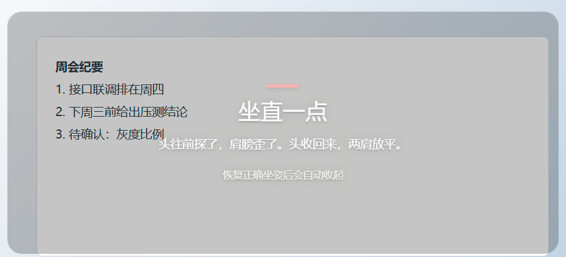

# 坐姿护卫 PostureGuard

用笔记本摄像头盯住你的坐姿。工作时段内持续驼背超过几秒，屏幕中央浮出一张半透明卡片，提醒你坐直。

摄像头画面**只在本机内存里处理**，不录制、不上传、不落地。

[English](README.en.md) · [下载安装](#下载与安装) · [使用说明](#使用说明) · [支持作者](#支持作者)

---

## 它解决什么问题

「记得坐直」这件事靠自觉基本无效——不是不知道，是不知道**此刻**已经塌下去了。
定时提醒（每 30 分钟弹一次）又太粗：你刚坐正它照样弹，你塌了一小时它可能正好没弹。

PostureGuard 做的是**持续判断**：4 FPS 跟踪头颈和双肩的关键点，用相对你自己校准过的姿势的偏移量来判定，
而不是绝对角度。所以身高、摄像头型号、桌子高低都不影响——它只关心「你现在比你自己最舒服的坐姿差了多少」。

## 功能

**四项指标，任一超标即判定不良**

| 指标 | 含义 | 正前方默认阈值 |
|---|---|---|
| 头颈前伸角 | 耳中点相对肩中点往前探的角度 | 超过基线 +6° |
| 肩线倾斜 | 左右肩高度差 | 偏离基线 ±4° |
| 身体下沉 | 肩膀比标定时低了几个「肩宽百分比」 | 下沉 >5% 肩宽 |
| 转头门控 | 鼻尖相对肩中线的偏移 | 超 0.15 倍肩宽则暂停颈角判定 |

前三项任一超阈值就开始累积时间，持续 3.5 秒弹卡；坐正 3 秒自动收起，之后 20 秒内不再打扰。

**其它**

- **机位预设**：正前方 / 左前方 45° / 右前方 45°，换机位自动换阈值并作废旧标定
- **久坐提醒**：连续检测到人坐满 N 分钟（默认 45）提醒起身
- **监控时段**：默认工作日 9:00–12:00、14:00–18:00，时段外自动释放摄像头
- **提醒卡片透明度可调**：40%–90%，默认 60%——既能看清背后的桌面，字也压得住
- **中英双语界面**：切换即时生效并记住选择
- **全局快捷键**：开会或共享屏幕时一键暂停，不必切回窗口
- **托盘常驻**：关窗口不退出，检测继续跑
- **多屏**：提醒卡片可以指定在哪块屏弹出，改了能当场预览

**卡片默认 60% 不透明度，背后的桌面内容仍然看得清：**



*示意图：背后的文档内容是虚构的*

## 下载与安装

到 [Releases](../../releases) 下载最新安装包：

- `PostureGuard-x.y.z-setup.exe` —— 安装版，**默认装到用户目录，不需要管理员权限**
  （`%LOCALAPPDATA%\Programs\PostureGuard`），安装时可自己改路径
- `PostureGuard-x.y.z-portable.exe` —— 便携版，免安装，适合放 U 盘带走

安装版和便携版共用同一份配置，装过一次之后再换着用不会丢设置。

**系统要求**：Windows 10/11 64 位，有摄像头。首次运行需要允许摄像头权限。

## 使用说明

### 1. 确认机位

首次启动会自动打开设置。笔记本摄像头一般在屏幕正上方，选「正前方」即可；
如果笔记本摆在身体侧面（外接显示器常见），要选对应的左前方 / 右前方 45°。

机位决定四项推荐阈值——45° 斜视时肩宽在画面里被压到约 0.7 倍，所有以肩宽为分母的量都会被同比例放大，
所以侧向阈值整体放宽。**机位选错，标定和阈值都会跟着偏。**

### 2. 标定

坐正，点「标定坐姿」，保持 5 秒。

程序记录你此刻的颈角、肩线、肩膀高度和肩宽，作为之后一切比较的基准。
标定结果可以勾选「记住」保存到磁盘，下次启动免标定——但**换机位、大改桌椅高度、或超过 7 天**就会自动作废。

### 3. 调阈值

觉得太吵就先只调大「头颈前伸角」；嫌它不管用就调小。
界面上的三档预设（宽松 / 标准 / 严格）只是把六个数字一次填好，方便起步。

### 4. 暂停

开会、共享屏幕时按 `Ctrl+Alt+Shift+P`（注册失败会依次尝试 `Ctrl+Alt+K`、`Ctrl+Shift+F9`），
或点窗口里的「暂停」。手动暂停后不会被时段自动启动顶掉。

## 隐私

- 摄像头画面只进入本机内存，交给本地的 MediaPipe 模型推理，**不写文件、不发网络请求**
- 程序只监听 `127.0.0.1` 上的一个本地静态服务，用于给界面加载页面和模型，不对外
- 所有设置与标定数据存在 `%APPDATA%\postureguard\settings.json`
- 没有任何统计、埋点、崩溃上报

## 从源码运行

需要 Node.js 18+ 和 npm。

```bash
git clone https://github.com/ahleung/PostureGuard.git
cd PostureGuard
npm install
npm start
```

打包：

```bash
npm run dist           # 安装包 → dist/PostureGuard-x.y.z-setup.exe
npm run dist:portable  # 便携版 → dist/PostureGuard-x.y.z-portable.exe
```

> 国内网络下 `electron-builder` 拉 `winCodeSign` / electron 分发包容易超时。
> 可以设 `ELECTRON_BUILDER_BINARIES_MIRROR=https://registry.npmmirror.com/-/binary/electron-builder-binaries/`，
> 或用 `-c.electronDist=node_modules/electron/dist` 直接用本地已解压的 Electron。

## 配置

配置文件：`%APPDATA%\postureguard\settings.json`

```jsonc
{
  "language": "zh",              // zh | en
  "autoLaunch": false,           // 开机启动
  "persistBaseline": false,      // 是否记住标定结果
  "schedule": {
    "weekdaysOnly": true,
    "segments": [[540, 720], [840, 1080]]   // 分钟数：9:00-12:00, 14:00-18:00
  },
  "thresholds": {
    "dAngle": 6, "dTilt": 4, "dDrop": 0.05, "dYaw": 0.15,
    "holdMs": 3500, "cooldownMs": 20000
  },
  "camera": "front",             // front | left45 | right45
  "sit": { "enabled": true, "minutes": 45 },
  "overlayDisplay": "auto",      // auto | 显示器 id
  "overlayOpacity": 0.6,         // 0.4 - 0.9
  "baseline": null               // 标定结果
}
```

改坏了删掉文件即可，下次启动按默认值重建。

## 自定义与二次开发

- **文案与翻译**：`src/i18n/zh.json`、`src/i18n/en.json`，两边键名一一对应，加语言就是再加一个文件
- **仓库地址与赞助入口**：`src/config/app-info.json`
- **收款码**：`assets/donate/wechat.png`，说明见 [`assets/donate/README.md`](assets/donate/README.md)
- **检测逻辑**：`src/core/geometry.js`（几何量）、`src/core/judge.js`（阈值与状态机）
- **界面**：`src/ui/`，主循环在 `monitor.js`

## 已知限制

- **必须标定**：所有判断都是相对量，没标定就不知道你的「标准坐姿」长什么样
- **单人**：只跟踪画面里置信度最高的一个人
- **弱光 / 逆光**下关键点会抖，表现为读数跳变——这时中值滤波能压一部分，但别指望和顺光一样稳
- **侧向机位的阈值是推算值**：由 `1/cos45° ≈ 1.41` 的投影关系放大得出，左右两个侧向目前共用同一组数字，缺少左右不对称的实测依据
- 身体下沉是唯一依赖绝对位置的指标，**换机器、换摄像头位置一定失效**——这也是换机位会作废基线的原因
- Windows 独占，没有 macOS / Linux 构建

## 支持作者

这个程序免费、开源、无广告。如果它让你少驼背了一点，可以请作者喝杯咖啡——金额随意。
入口在界面右上角「关于」里：一张微信赞赏码，扫码就能付，不用注册；想给得多一点或者需要订单记录的，那里也有爱发电的入口。

这是一份无偿赠与：不构成购买，也不附带任何服务承诺或回报。软件本身按 MIT 许可免费提供，所有功能都不收费。

**如果你是花钱买到的，说明有人赚了差价。** 这个软件完全免费，源码就在这个仓库里——直接下载，然后申请退款。

不想花钱也没关系：提个 issue、提个 PR、或者点个 Star，都是实在的支持。

## 许可

[MIT](LICENSE)
